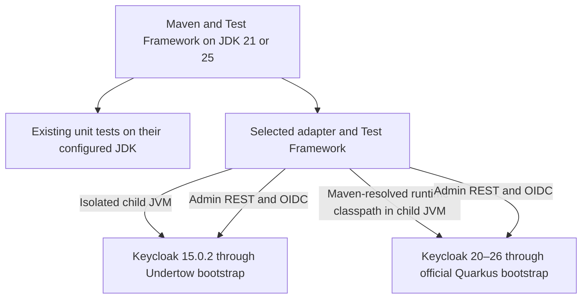

# Runtime and JDK boundaries

The extension JAR targets Java 21 and contains no Keycloak server libraries.
The version-specific runtime artifact contains only bootstrap classes and metadata.
The runtime Maven plugin resolves server dependencies and writes their paths to a descriptor under the integration module's test output directory.
The Quarkus extension starts Keycloak from Maven-resolved artifacts in a child JVM without downloading or installing a distribution ZIP.
The Undertow adapter provides a separate Keycloak 15.0.2 startup path for that older server generation.

Keycloak 20–26 use the official Quarkus bootstrap, with JDK 17 for 20–24, JDK 21 for 25, and JDK 25 for 26.

Configure exactly one runtime artifact as a dependency of `keycloak-test-runtime-maven-plugin`, not as a project test dependency.
Bind the plugin goal to `process-test-classes` so Maven and Failsafe runs prepare the child JVM classpath.
The selected runtime artifact determines the Keycloak version; `kc.test.runtime.version` can optionally assert that selection.

The GLOBAL server is shared within one Framework registry/test JVM.
`@ResetKeycloakState` activates a CLASS-scoped managed snapshot through the selected server adapter's supplier; `@InjectSnapshot` is optional and exposes manual snapshot operations.
Test code depends only on the shared `Snapshot` API; each adapter supplies the database-specific implementation.
The snapshot captures state after declarative resources and `@TestSetup` exist, then restores it after each method.
A request barrier quiesces supported HTTP requests during restore, and Keycloak caches are cleared before the saved session entries are restored.
LDAP fixtures implement the shared snapshot participant API so their data follows the same capture and restore lifecycle.

See [snapshot lifecycle and boundaries](snapshot.md).
