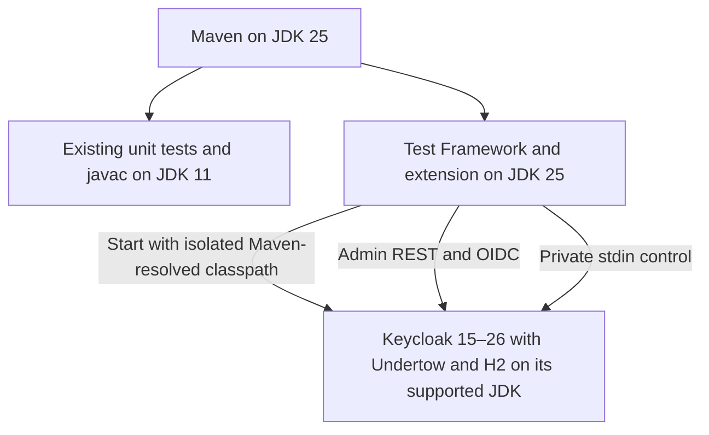

# Runtime and JDK boundaries

The extension JAR targets Java 21 and contains no Keycloak server dependencies. The version adapter JAR contains only the runtime bootstrap classes. Server dependencies are resolved in the Maven plugin class realm, which writes a classpath descriptor under the integration module’s test output directory; the extension passes that classpath to the child JVM.
Keycloak 15 has a Java 11 runtime artifact; versions 20–26 have one artifact per supported Keycloak version, with server JDKs 17, 21, or 25 as listed in the README.
The modern variants share most runtime code and carry version-specific bootstrap configuration, servlet namespace, and compatibility adapters.
Configure the matching runtime artifact as a dependency of `keycloak-test-runtime-maven-plugin`, not as a project test dependency. Bind the plugin goal to `process-test-classes` so Maven and Failsafe runs prepare the child JVM classpath.
The runtime Maven plugin prepares exactly one selected runtime per integration-test module. Set `kc.test.undertow.version` when selecting among supported versions.

The GLOBAL server is shared within one Framework registry/test JVM.
`@InjectH2Snapshot` creates a CLASS-scoped managed resource through the existing Framework supplier interface.
It captures H2 rows after declarative resources exist and uses Framework cleanup to restore them after each method.
A barrier coordinates synchronous HTTP requests and standard timer tasks during restore.
The runtime evicts model caches and restores serialized baseline user/client sessions.
Class cleanup releases the baseline before deleting that class's fixtures.

See [H2 snapshot lifecycle and boundaries](h2-snapshot.md).
