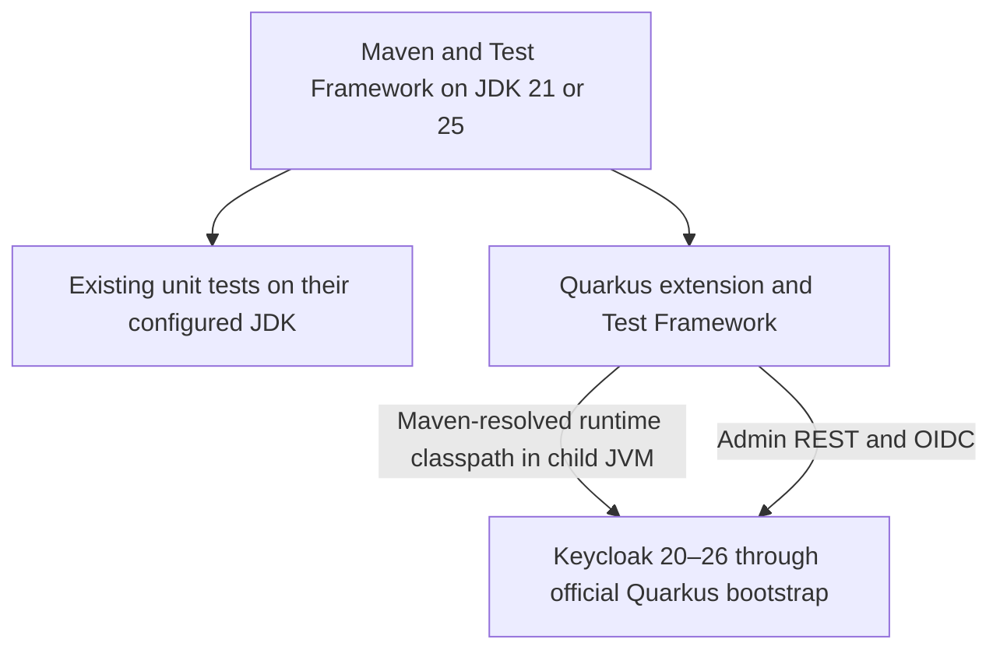

# Runtime and JDK boundaries

The extension JAR targets Java 21 and contains no Keycloak server libraries.
The version-specific runtime artifact contains only bootstrap classes and metadata.
The runtime Maven plugin resolves server dependencies and writes their paths to a descriptor under the integration module's test output directory.
The Quarkus extension starts Keycloak from Maven-resolved artifacts in a child JVM without downloading or installing a distribution ZIP.

Keycloak 20–26 use the official Quarkus bootstrap, with JDK 17 for 20–24, JDK 21 for 25, and JDK 25 for 26.

Configure exactly one runtime artifact as a dependency of `keycloak-test-runtime-maven-plugin`, not as a project test dependency.
Bind the plugin goal to `process-test-classes` so Maven and Failsafe runs prepare the child JVM classpath.
Use `kc.test.runtime.version` to check the selected Keycloak version.

The GLOBAL server is shared within one Framework registry/test JVM.
`@InjectQuarkusH2Snapshot` creates a CLASS-scoped managed resource through the Framework supplier interface.
It captures H2 rows after declarative resources exist and restores them after each method.
A request barrier quiesces supported HTTP requests during restore, and Keycloak caches are cleared before the saved session entries are restored.
LDAP fixtures implement the shared snapshot participant API so their data follows the same capture and restore lifecycle.

See [H2 snapshot lifecycle and boundaries](h2-snapshot.md).
