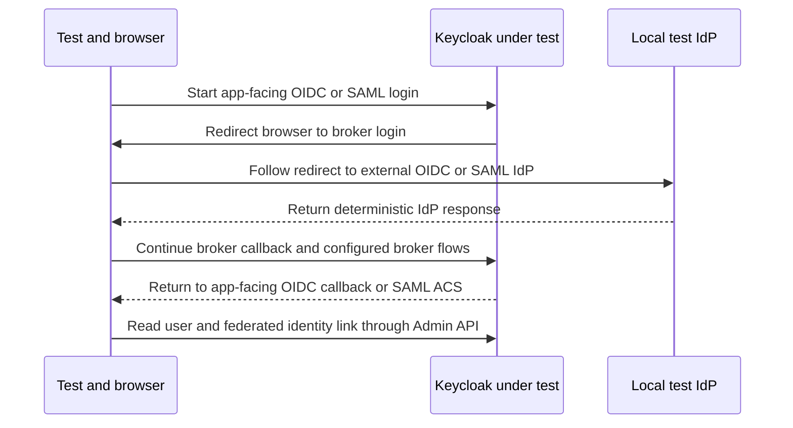

# Broker authentication testing

The `extension-broker` module provides OIDC and SAML test IdPs and a broker-link query API.
The integration tests exercise browser-mediated login through both protocols.

This extension targets Keycloak administrators and SPI developers who need deterministic tests for identity brokering. It is a Keycloak test helper, not a production OIDC/SAML provider implementation.

## Test topology



The IdP fixture runs in the test JVM and binds to a dynamic loopback port. The process-managed Keycloak server can reach it from the same host. A containerized or remote Keycloak needs an explicitly reachable test IdP URL instead of loopback.

## Protocol roles

The test IdP is separate from the app-facing test client:

| Role | OIDC | SAML |
| --- | --- | --- |
| Start login to Keycloak under test | Framework `OAuthClient` | Extension `SamlClient` |
| Simulate the external IdP | `OidcTestIdentityProvider` | `SamlTestIdentityProvider` |
| Complete and inspect the app-facing response | Framework OIDC token/user-info helpers | Extension's validated SAML ACS result |

The Framework `OAuthIdentityProvider` helper serves OIDC discovery metadata and JWKS, which is useful for token-verification tests but does not implement a complete interactive authorization-code broker flow. The extension's OIDC test IdP provides authorization, token, signing-key, and user-info endpoints for deterministic broker login.

## Test IdP API

Provide protocol-specific injected fixtures with class/global lifecycle and explicit per-login identity setup:

```java
@InjectOidcTestIdentityProvider
OidcTestIdentityProvider oidcIdp;

@InjectSamlTestIdentityProvider
SamlTestIdentityProvider samlIdp;
```

Both fixtures expose their endpoints, a Keycloak broker configuration map, and a one-shot identity response setter. OIDC responses include a stable subject and configurable claims such as username, email, and email-verification state. SAML responses include a stable NameID, NameID format, and configurable attributes. They generate and publish their signing keys; tests do not handcraft JWTs, XML, or signatures. Call `denyNextLogin()` to return an OIDC access-denied result or SAML AuthnFailed response for the next attempt.

These IdP fixtures and broker-link queries are packaged in the separate `keycloak-test-framework-broker` artifact.
The app-facing SAML client stays in `keycloak-test-framework-saml`; tests using SAML on both sides can depend on both artifacts.

Before starting a login, the test selects the next external identity, for example `oidcIdp.nextLogin(OidcIdentity.subject("directory-42").claim("email", "alice@example.test"))`. The OIDC fixture serves discovery, JWKS, authorization, token, and user-info endpoints. It validates the redirect URI and returns the authorization state, then issues a single-use code and a signed ID token containing the expected issuer, audience, and nonce. The SAML fixture serves metadata and an SSO endpoint, accepts Redirect and POST AuthnRequest bindings, and returns a signed POST response with matching `InResponseTo`, destination, recipient, audience, and RelayState. Both fixtures complete the browser redirect automatically. This keeps the test focused on Keycloak's broker configuration. The fixtures do not provide an IdP login UI; use a second Keycloak when the external provider's own login UI or implementation must be tested.

Create and configure the identity provider in the managed realm using the Framework's `IdentityProviderBuilder` and Admin API. Set the alias, mapper configuration, `firstBrokerLoginFlowAlias`, and `postBrokerLoginFlowAlias` explicitly. The IdP fixture contributes protocol endpoint and key settings; register created provider and mapper resources for cleanup with the managed realm.

The app-facing browser flow remains interactive. Use `oauth.loginForm().open()` or `saml.startLogin()`, then drive every expected Keycloak screen with Framework page objects or Selenium. This allows assertions and actions at custom authenticators, consent pages, account-link confirmation, and required actions before the final protocol response is checked.

## Scenarios covered

The OIDC integration test configures an IdP mapper, returns a known external claim, exercises the `VERIFY_PROFILE` required action, and asserts the mapped local user attribute and federated identity link.
The SAML integration test completes a first-broker-login profile review and asserts the federated identity link.
The OIDC post-login-flow test starts with an already-linked user, returns through the external IdP, drives an additional username/password authenticator, and validates the final OIDC response.
The browser-backed client helpers expose the browser while a flow is in progress, so tests can assert and interact with intermediate Keycloak pages.

## Broker-link query API

The Framework exposes `ManagedUser.admin().getFederatedIdentity()` for a known local user. For users created during broker login, the extension provides a read-only helper:

```java
BrokeredUser brokeredUser = BrokerIdentityLinks.forRealm(realm).findByUsername("alice");
BrokerIdentityLink link = brokeredUser.identityProvider("partner").orElseThrow();
assertEquals("directory-42", link.externalUserId());
assertEquals("alice", link.externalUsername());
assertTrue(brokeredUser.identityProvider("other-provider").isEmpty());
```

`BrokerIdentityLinks.forRealm(realm).findByUsername(...)` and `findById(...)` query the Keycloak Admin API. `BrokeredUser` contains the local user id, username, and immutable list of links. `BrokerIdentityLink` contains provider alias, external user id, and external username. Keep assertions in JUnit/AssertJ; the helper only queries and normalizes Admin API data. Returning `Optional` for a missing alias lets tests assert both presence and absence without mutation.

## Scope and limitations

The test IdPs are intentionally small and deterministic.
They do not reproduce arbitrary third-party IdP UIs, logout, all OIDC extensions, SAML encryption, or every signature algorithm.
Use a separate Keycloak server when the test needs implementation-to-implementation interoperability rather than Keycloak configuration behavior.

## Custom authenticators and required actions

Start the OIDC or SAML app-facing login and keep the returned flow object.
For SAML, `flow.browser()` returns the Framework-managed browser; for OIDC, use the injected `ManagedWebDriver` associated with the `OAuthClient`.
After each expected screen, create the matching Framework page object or use Selenium through `browser.driver()`.
This is the same interaction pattern used by the post-login integration test, which handles an extra authenticator screen after the broker has identified an already-linked user.

For an application-defined authenticator, install its provider in the Keycloak runtime used by the test and supply a page object for its theme form.
The extension does not define the authenticator SPI or assume a fixed screen sequence.
Built-in required actions such as profile update can be tested in the same way by adding the action to the user or by using the first broker login flow's review-profile step.

The test IdP fixture runs outside Keycloak and simulates only the external identity provider.
This lets the browser cross the broker redirect and return to Keycloak without starting or testing another Keycloak instance.

## Version and dependency notes

The SPI/provider module and Framework integration-test module remain separate Maven modules. The integration module owns the current Framework test APIs and the test IdP fixtures; the SPI module compiles against its target Keycloak API. The test IdP fixtures must avoid linking to Keycloak server internals so that the process-managed server remains isolated from the test runner's provider implementation.
