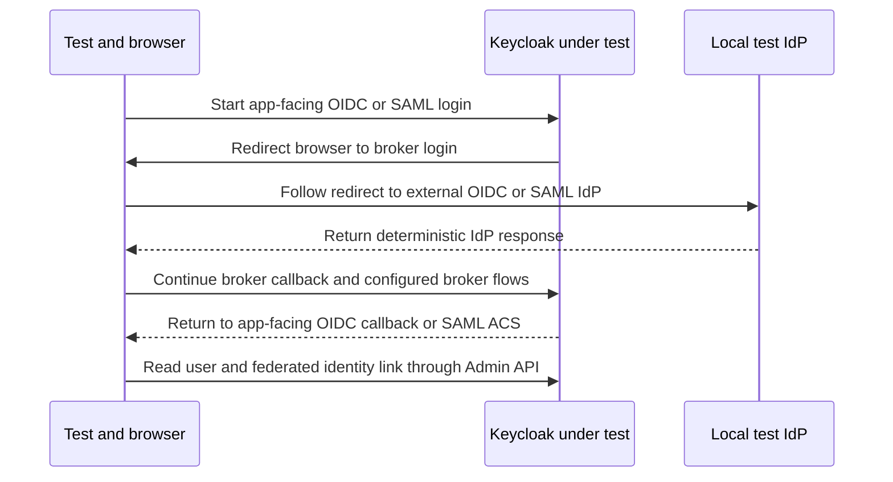

# Broker authentication test design

The extension-broker module now contains the proposed IdP fixtures and broker-link query API. The browser-mediated broker flows have not yet been tested end to end.

This extension targets Keycloak administrators and SPI developers who need deterministic tests for identity brokering. It is a Keycloak test helper, not a production OIDC/SAML provider implementation.

## Test topology



The IdP fixture runs in the test JVM and binds to a dynamic loopback port. The process-managed Keycloak server can reach it from the same host. A containerized or remote Keycloak needs an explicitly reachable test IdP URL instead of loopback.

## Protocol roles

The test IdP is separate from the app-facing test client:

| Role | OIDC | SAML |
| --- | --- | --- |
| Start login to Keycloak under test | Framework `OAuthClient` | Extension `SamlClient` |
| Simulate the external IdP | New `OidcTestIdentityProvider` | New `SamlTestIdentityProvider` |
| Complete and inspect the app-facing response | Framework OIDC token/user-info helpers | Extension's validated SAML ACS result |

The current Framework `OAuthIdentityProvider` helper serves OIDC discovery metadata and JWKS, which is useful for token-verification tests but does not implement a complete interactive authorization-code broker flow. The proposed test IdP provides authorization, token, signing-key, and user-info endpoints for deterministic broker login.

## Proposed public API

Provide protocol-specific injected fixtures with class/global lifecycle and explicit per-login identity setup:

```java
@InjectOidcTestIdentityProvider
OidcTestIdentityProvider oidcIdp;

@InjectSamlTestIdentityProvider
SamlTestIdentityProvider samlIdp;
```

Both fixtures expose their endpoints, a Keycloak broker configuration map, and a one-shot identity response setter. OIDC responses include a stable subject and configurable claims such as username, email, and email-verification state. SAML responses include a stable NameID, NameID format, and configurable attributes. They generate and publish their signing keys; tests do not handcraft JWTs, XML, or signatures. Call `denyNextLogin()` to return an OIDC access-denied result or SAML AuthnFailed response for the next attempt.

These IdP fixtures and broker-link queries are packaged in the separate `keycloak-test-framework-broker` artifact. The app-facing SAML client stays in `keycloak-test-framework-saml`; users can depend on both when their test uses a SAML app and an external broker.

Before starting a login, the test selects the next external identity, for example `oidcIdp.nextLogin(OidcIdentity.subject("directory-42").claim("email", "alice@example.test"))`. The OIDC fixture serves discovery, JWKS, authorization, token, and user-info endpoints. It validates the redirect URI and returns the authorization state, then issues a single-use code and a signed ID token containing the expected issuer, audience, and nonce. The SAML fixture serves metadata and an SSO endpoint, accepts Redirect and POST AuthnRequest bindings, and returns a signed POST response with matching `InResponseTo`, destination, recipient, audience, and RelayState. Both fixtures complete the browser redirect automatically. This keeps the test focused on Keycloak's broker configuration. Optional IdP UI simulation is outside the first API; use a second Keycloak when the external provider's own login UI or implementation must be tested.

Tests create/configure the identity provider in the managed realm using the Framework's `IdentityProviderBuilder` and Admin API. The test must be able to set the alias, mapper configuration, `firstBrokerLoginFlowAlias`, and `postBrokerLoginFlowAlias` explicitly. The IdP fixture contributes only protocol endpoint/key settings. Created provider and mapper resources must register cleanup with the managed realm.

The app-facing browser flow remains interactive. Use `oauth.loginForm().open()` or `saml.startLogin()`, then drive every expected Keycloak screen with Framework page objects or Selenium. This allows assertions and actions at custom authenticators, consent pages, account-link confirmation, and required actions before the final protocol response is checked.

## Scenarios this supports

1. **Broker mappers:** configure an IdP mapper, return a known external subject and claims/attributes, log in, then assert the resulting local user's username, email, attributes, and roles.
2. **First Broker Login Flow:** use a new external subject to test automatic user creation, review-profile screens, required actions, existing-account matching, confirmation, rejection, or explicit account linking.
3. **Post Broker Login Flow:** authenticate with an already-linked external subject, drive custom steps, and assert both the final app-facing response and resulting local user state.
4. **Link lifecycle:** assert that the correct local user has a link for the expected IdP alias and external subject; after unlink/rejection, assert that the link is absent.

## Broker-link query API

The Framework already exposes `ManagedUser.admin().getFederatedIdentity()` for a known local user. To make broker-created users equally straightforward to inspect, add a small read-only helper:

```java
BrokeredUser brokeredUser = BrokerIdentityLinks.forRealm(realm).findByUsername("alice");
BrokerIdentityLink link = brokeredUser.identityProvider("partner").orElseThrow();
assertEquals("directory-42", link.externalUserId());
assertEquals("alice", link.externalUsername());
assertTrue(brokeredUser.identityProvider("other-provider").isEmpty());
```

`BrokerIdentityLinks.forRealm(realm).findByUsername(...)` and `findById(...)` query the Keycloak Admin API. `BrokeredUser` contains the local user id, username, and immutable list of links. `BrokerIdentityLink` contains provider alias, external user id, and external username. Keep assertions in JUnit/AssertJ; the helper only queries and normalizes Admin API data. Returning `Optional` for a missing alias lets tests assert both presence and absence without mutation.

## Scope and limitations

The first version should support SP-initiated external OIDC and SAML broker flows, successful and denied IdP responses, mapper-visible identity data, first/post broker flows, and link inspection. The test IdPs are intentionally small and deterministic. They do not aim to reproduce arbitrary third-party IdP UIs, logout, all OIDC extensions, SAML encryption, or every signature algorithm. A separate Keycloak server should be used when the test needs implementation-to-implementation interoperability rather than Keycloak configuration behavior.

## Version and dependency notes

The SPI/provider module and Framework integration-test module remain separate Maven modules. The integration module owns the current Framework test APIs and the test IdP fixtures; the SPI module compiles against its target Keycloak API. The test IdP fixtures must avoid linking to Keycloak server internals so that the process-managed server remains isolated from the test runner's provider implementation.
